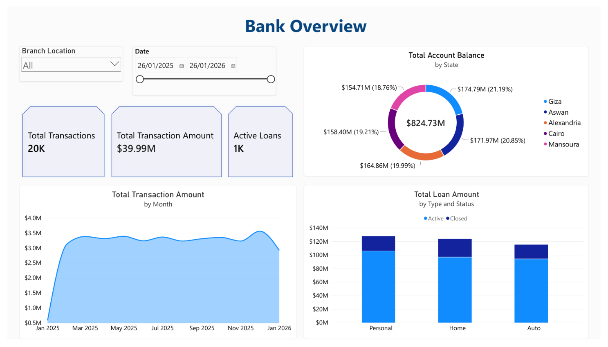
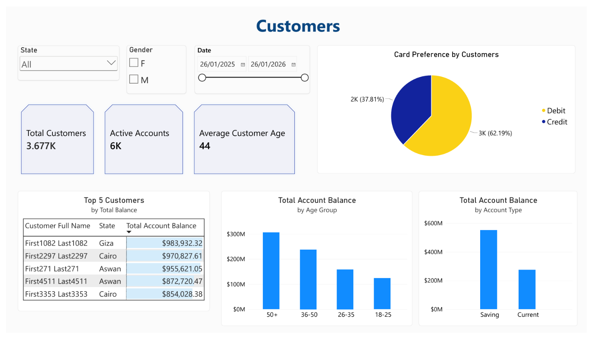
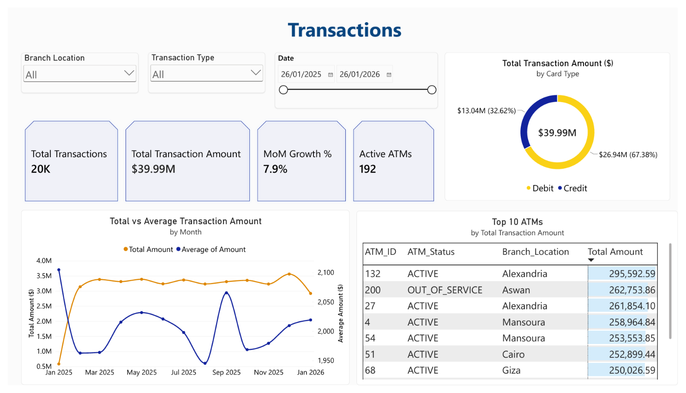
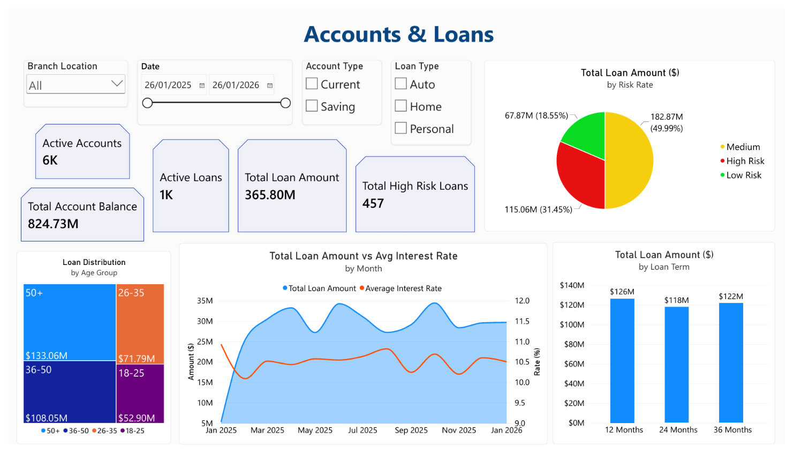
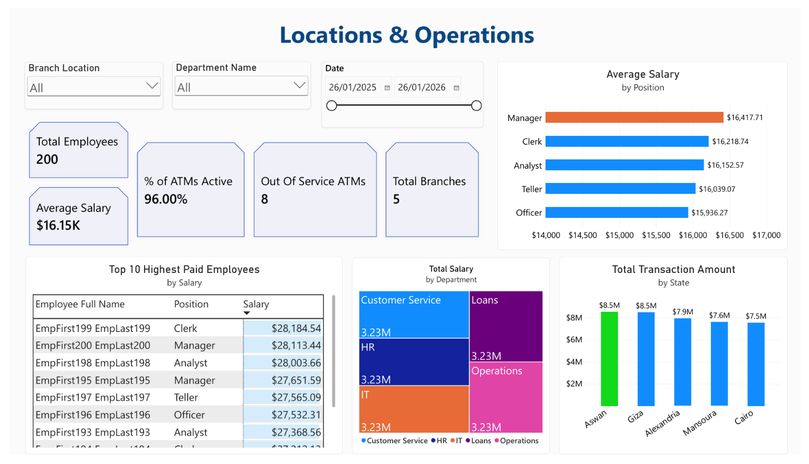

##### **Data Analysis Camp Final Project (2nd Place)**

###### **Project Overview**

This project was completed during the Human For Good Data Analysis Camp. I analyzed Bank database to identify key trends and insights. 

The project achieved 2nd Place in the final project competition.

###### **Dashboard Preview**

###### **Tools Used**

* Microsoft Power BI
* SQL
* Excel

###### **Presentation**
A PowerPoint presentation explaining the project insights is included in this repository as `[BankDB_Presentation_by Aya Mohab.pptx]`.

